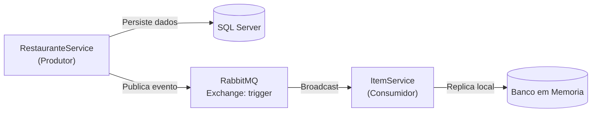
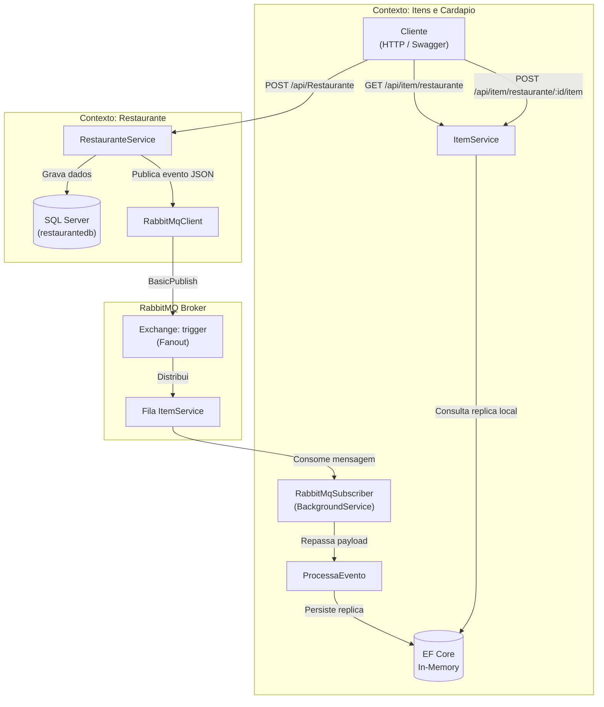

# restaurant-microservices-integration

Integracao assincrona orientada a eventos entre microsservicos utilizando .NET 8, RabbitMQ, SQL Server e Docker Compose.



### Resumo Tecnico

| Componente | Detalhe | Finalidade |
| :--- | :--- | :--- |
| RestauranteService | .NET 8 Web API / EF Core 8 | Servico produtor e dono dos dados cadastrais |
| ItemService | .NET 8 Web API / EF Core In-Memory | Servico consumidor e gestor de itens/cardapio |
| RabbitMQ | Exchange Fanout (trigger) | Broker AMQP para desacoplamento temporal e estrutural |
| SQL Server 2019 | Base restaurantedb | Persistencia relacional com migrations automaticas |
| Docker Compose | Rede interna bridge (restaurante-network) | Orquestracao unificada de todos os servicos |

### Acesso Rapido aos Servicos

| Servico | Interface | Endereco Local | Credenciais |
| :--- | :--- | :--- | :--- |
| RestauranteService | Swagger UI | http://localhost:8081/swagger | Nao requer |
| ItemService | Swagger UI | http://localhost:8080/swagger | Nao requer |
| RabbitMQ Management | Painel Web | http://localhost:15672 | guest / guest |
| SQL Server | Porta TCP | localhost:1433 | sa / Teste123! |

---

## Sumário
- [1. Visão Geral](#1-visão-geral)
- [2. Arquitetura e Fluxo de Mensageria](#2-arquitetura-e-fluxo-de-mensageria)
  - [2.1. Diagrama de Fluxo](#21-diagrama-de-fluxo)
  - [2.2. Funcionamento do RabbitMQ](#22-funcionamento-do-rabbitmq)
  - [2.3. Idempotência e Replicação Local](#23-idempotência-e-replicação-local)
- [3. Microsserviços](#3-microsserviços)
  - [RestauranteService](#restauranteservice)
  - [ItemService](#itemservice)
  - [RabbitMQ](#rabbitmq)
- [4. Pré-requisitos](#4-pré-requisitos)
- [5. Execução com Docker Compose](#5-execução-com-docker-compose)
  - [Passo a Passo](#passo-a-passo)
  - [Portas e URLs](#portas-e-urls)
- [6. Teste Prático Ponta a Ponta](#6-teste-prático-ponta-a-ponta)
- [7. Variáveis de Ambiente](#7-variáveis-de-ambiente)
- [8. Manutenção e Depuração Local](#8-manutenção-e-depuração-local)
  - [Comandos Docker Úteis](#comandos-docker-úteis)
  - [Depuração Local via IDE](#depuração-local-via-ide)
  - [Possíveis Problemas](#possíveis-problemas)
- [9. Capturas de Tela](#9-capturas-de-tela)

---

## 1. Visão Geral

Este projeto aborda um problema clássico de arquitetura distribuída: como manter dados sincronizados entre serviços diferentes sem criar dependência direta via HTTP.

Em vez de fazer o ItemService consultar o RestauranteService a cada requisição para saber se um restaurante existe, o sistema utiliza mensageria assíncrona. Quando um novo restaurante é cadastrado no RestauranteService, um evento é publicado no RabbitMQ. O ItemService consome essa mensagem e armazena uma cópia local do restaurante em sua própria base, ficando autônomo para responder suas requisições.

---

## 2. Arquitetura e Fluxo de Mensageria

### 2.1. Diagrama de Fluxo

O fluxo de comunicação e separação entre contextos segue a estrutura abaixo:



---

### 2.2. Funcionamento do RabbitMQ

- Exchange Fanout (trigger): o publicador envia mensagens para uma exchange do tipo Fanout chamada trigger. Esse tipo de exchange transmite a mensagem para todas as filas conectadas a ela, sem avaliar chaves de roteamento (routingKey). Isso facilita plugar novos serviços consumidores no futuro sem mexer no publicador.
- Declaração dinâmica da fila: no ItemService, a classe RabbitMqSubscriber declara uma fila anônima e exclusiva ao iniciar e a conecta à exchange trigger.
- Serialização: os eventos trafegam como JSON serializado via System.Text.Json em UTF-8. O payload contém os campos básicos do restaurante: Id, Nome, Endereco e Site.
- Processamento em segundo plano: o consumo de mensagens no ItemService roda dentro de um BackgroundService (IHostedService), processando os eventos de forma não-bloqueante em relação à API HTTP.

---

### 2.3. Idempotência e Replicação Local

Em sistemas orientados a eventos, uma mensagem pode ser entregue mais de uma vez devido a reconexões ou falhas transitórias. Para evitar duplicidades:

1. O ItemService mapeia o Id recebido do RestauranteService para a propriedade IdExterno do seu modelo local.
2. Antes de gravar o registro, a classe ProcessaEvento consulta o repositório local:

```csharp
if (!itemRepository.ExisteRestauranteExterno(restaurante.Id))
{
    itemRepository.CreateRestaurante(restaurante);
    itemRepository.SaveChanges();
}
```

Se o identificador já existir na base local, a mensagem é descartada sem duplicar informações.

---

## 3. Microsserviços

### RestauranteService
- Responsabilidade: cadastro e manutenção dos dados de restaurantes (dono do dado).
- Banco de dados: SQL Server (restaurantedb). As migrações do Entity Framework Core são aplicadas automaticamente na inicialização da aplicação (db.Database.Migrate()).
- Endpoints principais:
  - GET /api/Restaurante: lista todos os restaurantes.
  - GET /api/Restaurante/{id}: consulta um restaurante por ID.
  - POST /api/Restaurante: insere o restaurante no SQL Server e publica o evento no RabbitMQ.

### ItemService
- Responsabilidade: gerenciamento de cardápio e itens associados a restaurantes.
- Banco de dados: EF Core In-Memory Database. Funciona como réplica local de leitura, garantindo que o serviço consiga validar a existência de um restaurante sem fazer chamadas síncronas de rede ao RestauranteService.
- Endpoints principais:
  - GET /api/item/restaurante: lista os restaurantes replicados localmente.
  - GET /api/item/restaurante/{restauranteId}/item: lista itens do cardápio de determinado restaurante.
  - GET /api/item/restaurante/{restauranteId}/item/{itemId}: busca um item específico.
  - POST /api/item/restaurante/{restauranteId}/item: adiciona um item ao restaurante (valida antes se o restaurante existe na réplica local).

### RabbitMQ
- Responsabilidade: intermediar a troca assíncrona de mensagens, isolando o ciclo de vida dos microsserviços. O RestauranteService não depende de o ItemService estar ativo ou respondendo no mesmo instante da chamada.

---

## 4. Pré-requisitos

- Docker e Docker Compose instalados
- .NET 8.0 SDK (necessário apenas se for rodar ou compilar fora do Docker)
- Cliente HTTP (curl, Postman, Insomnia ou navegador via Swagger)

---

## 5. Execução com Docker Compose

### Passo a Passo

1. Clone o repositório:
   ```bash
   git clone https://github.com/Jonas-Emir/restaurant-microservices-integration.git
   cd restaurant-microservices-integration
   ```

2. (Opcional) Crie o arquivo de variáveis a partir do exemplo:
   ```bash
   cp .env.example .env
   ```

3. Suba todos os serviços:
   ```bash
   docker compose up -d --build
   ```

4. Verifique o status dos containers:
   ```bash
   docker compose ps
   ```

---

### Portas e URLs

| Serviço | Interface | URL | Credenciais |
| :--- | :--- | :--- | :--- |
| RestauranteService | Swagger UI | http://localhost:8081/swagger | Não requer |
| ItemService | Swagger UI | http://localhost:8080/swagger | Não requer |
| RabbitMQ | Painel Administrativo | http://localhost:15672 | guest / guest |
| SQL Server | Porta TCP | localhost:1433 | sa / Teste123! |

---

## 6. Teste Prático Ponta a Ponta

Execute os passos a seguir para validar o fluxo completo:

### Passo 1: Cadastrar restaurante no RestauranteService

Envie uma requisição POST criando um novo restaurante:

```bash
curl -X 'POST' \
  'http://localhost:8081/api/Restaurante' \
  -H 'Content-Type: application/json' \
  -d '{
  "nome": "Restaurante Exemplo",
  "endereco": "Rua das Flores, 123",
  "site": "https://restauranteexemplo.com.br"
}'
```

Resposta esperada (HTTP 201):
```json
{
  "id": 1,
  "nome": "Restaurante Exemplo",
  "endereco": "Rua das Flores, 123",
  "site": "https://restauranteexemplo.com.br"
}
```

### Passo 2: Acompanhar tráfego no RabbitMQ

Acesse o painel do RabbitMQ em http://localhost:15672 (usuário guest, senha guest).
Na aba Exchanges, abra a exchange trigger. Verifique que ela possui uma fila associada e que houve tráfego de mensagem no gráfico de mensagens entregues.

### Passo 3: Inspecionar logs do ItemService

Visualize os logs do container do ItemService para confirmar que a mensagem foi recebida:

```bash
docker compose logs -f itemservice
```

### Passo 4: Validar os dados replicados no ItemService

Consulte o endpoint de restaurantes do ItemService:

```bash
curl -X 'GET' 'http://localhost:8080/api/item/restaurante'
```

Resposta esperada:
```json
[
  {
    "id": 1,
    "nome": "Restaurante Exemplo"
  }
]
```

O restaurante cadastrado no RestauranteService foi replicado no ItemService sem que nenhuma chamada HTTP direta ocorresse entre os dois serviços.

### Passo 5: Cadastrar um item no cardápio

Com o restaurante sincronizado, adicione um item ao cardápio dele:

```bash
curl -X 'POST' \
  'http://localhost:8080/api/item/restaurante/1/item' \
  -H 'Content-Type: application/json' \
  -d '{
  "nome": "Prato Executivo",
  "preco": 35.50
}'
```

Em seguida, consulte a lista de itens:

```bash
curl -X 'GET' 'http://localhost:8080/api/item/restaurante/1/item'
```

---

## 7. Variáveis de Ambiente

As aplicações utilizam as seguintes configurações (definidas no appsettings.json ou sobrescritas via container):

### RestauranteService

| Variável | Descrição | Padrão no Compose |
| :--- | :--- | :--- |
| ASPNETCORE_ENVIRONMENT | Ambiente de execução | Production |
| ASPNETCORE_HTTP_PORTS | Porta HTTP do container | 80 |
| ASPNETCORE_URLS | URL de escuta interna | http://+:80 |
| ConnectionStrings__RestauranteConnection | String de conexão do SQL Server | Server=sql1;Database=restaurantedb;User Id=sa;Password=Teste123!;TrustServerCertificate=True; |
| RabbitMQHost | Endereço do broker RabbitMQ | rabbitmq-service |
| RabbitMQPort | Porta do broker RabbitMQ | 5672 |

### ItemService

| Variável | Descrição | Padrão no Compose |
| :--- | :--- | :--- |
| ASPNETCORE_ENVIRONMENT | Ambiente de execução | Production |
| ASPNETCORE_HTTP_PORTS | Porta HTTP do container | 80 |
| ASPNETCORE_URLS | URL de escuta interna | http://+:80 |
| RabbitMQHost | Endereço do broker RabbitMQ | rabbitmq-service |
| RabbitMQPort | Porta do broker RabbitMQ | 5672 |

---

## 8. Manutenção e Depuração Local

### Comandos Docker Úteis

- Parar os containers:
  ```bash
  docker compose down
  ```

- Parar os containers e apagar os volumes de dados:
  ```bash
  docker compose down -v
  ```

- Rebuildar apenas um serviço específico:
  ```bash
  docker compose up -d --build itemservice
  ```

- Visualizar logs em tempo real:
  ```bash
  docker compose logs -f
  ```

---

### Depuração Local via IDE

Para rodar os serviços em modo de debug na sua IDE (Visual Studio, VS Code ou Rider):

1. Inicie apenas o banco de dados e o RabbitMQ via Docker:
   ```bash
   docker compose up -d sql1 rabbitmq-service
   ```

2. Ajuste o arquivo appsettings.Development.json dos projetos para apontar para localhost:
   - No RestauranteService:
     ```json
     {
       "ConnectionStrings": {
         "RestauranteConnection": "Server=localhost;Database=restaurantedb;User Id=sa;Password=Teste123!;TrustServerCertificate=True;"
       },
       "RabbitMQHost": "localhost",
       "RabbitMQPort": "5672"
     }
     ```
   - No ItemService:
     ```json
     {
       "RabbitMQHost": "localhost",
       "RabbitMQPort": "5672"
     }
     ```

3. Inicie as aplicações pela IDE (F5) ou via linha de comando:
   ```bash
   # Terminal 1
   dotnet run --project RestauranteService/RestauranteService.csproj

   # Terminal 2
   dotnet run --project ItemService/ItemService.csproj
   ```

---

### Possíveis Problemas

- Demora na inicialização do SQL Server: em computadores mais lentos, o container do SQL Server pode demorar alguns segundos a mais para aceitar conexões. A política restart: on-failure no Docker Compose garante que o RestauranteService tente reconectar até o banco ficar pronto.
- Portas ocupadas: se as portas 8080, 8081, 1433 ou 5672 já estiverem em uso no seu sistema operacional, altere a porta mapeada à esquerda no docker-compose.yml (por exemplo, "8082:80").

---

## 9. Capturas de Tela

<details>
<summary>Visualizar imagens do ambiente e interfaces</summary>

### Diagrama de Mensageria


### Painel do RabbitMQ


### Swagger do RestauranteService


### Swagger do ItemService


### Containers em Execução


### Imagens Docker


</details>
